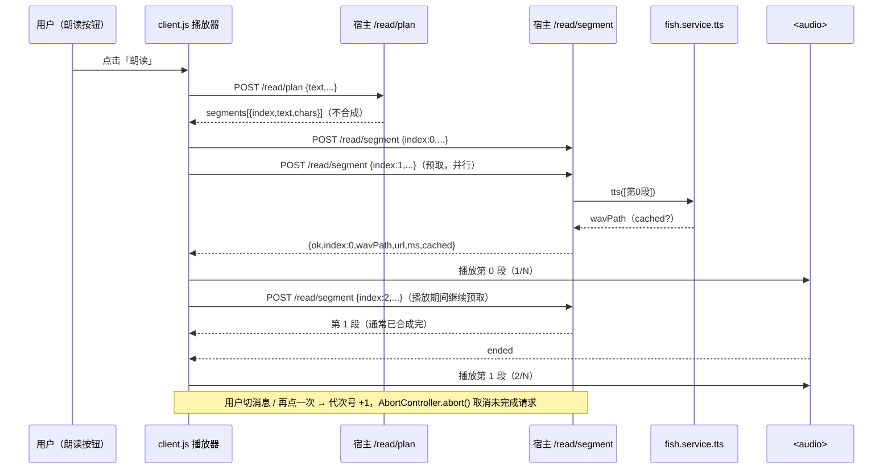

# TTS 缓存 / 分段并发 / 流式朗读

> 状态：**已完成**（2026-11-09，v0.2.0 性能修复）。
> 范围：`lib/service-api.js` 的 `tts()`、`lib/routes.js` 的 `/read*` 与 `/cache/*`、
> `lib/cache.js` 的 `clear()`、`client.js` 的朗读播放器、设置页。
> 目标：长文首段更快出声；同一句话重复朗读直接复用音频；并发度可配置且失败能降级。

---

## 1. 为什么之前「缓存没生效」

`tts()` 原来的缓存 key 是

```js
sha16(JSON.stringify([text, voice, speed, emotion, seed]))
```

但**只有 `body.seed !== undefined` 时才去 `findByKey`**。自动朗读、`fish_tts` 的默认调用都不传
`seed`，于是每次都真的请求 `/tts` 重新合成 —— 缓存文件写进去了，却永远查不到。

修复后：**无论有没有 seed 都算 key、都查缓存**。

---

## 2. 缓存 key 与命中规则

| 场景 | key 的组成（数组 JSON 后 sha16） | 说明 |
| --- | --- | --- |
| 不传 seed（默认 / 自动朗读） | `[text, voice, speed, emotion, "auto"]` | 服务端每次随机 seed，但同一组参数复用**最近一次**合成的音频 |
| 传 seed（`fish_tts` 显式固定） | `[text, voice, speed, emotion, seed]` | 固定 seed 的可复现语义不变 |
| 传不同的 voice / speed / emotion | 对应字段变化 → 不同 key | 换音色 / 换语速 / 换情绪会**重新合成** |

要点：

- key 里**没有 `ms`、时间戳、请求 id**，所以同一句话第二次朗读会稳定命中；
- 命中时 `tts()` 直接返回：
  `{wavPath, ms: 0, voice, bytes, cached: true}`，**不发任何 HTTP 请求**；
- 未命中时照旧请求 `/tts`，响应写入 `cacheDir/tts/<key>-<ts>.wav`，`cached: false`；
- 有 seed 和无 seed 的 key 互不串用（`"auto"` 是字符串，不会和数字 seed 冲突）；
- 同一个请求里出现两段完全相同的文本时，第二段会命中第一段刚写入的缓存
  （`/read` 的 `cachedChunks` 会体现）。

> 语义是「相同文本 + 音色 + 语速 + 情绪 → 复用音频」。服务端不传 seed 时本来是随机音色细节，
> 复用缓存意味着同一句话重复朗读听起来**完全一致**，这也正是自动朗读想要的效果。

---

## 3. 命中统计

统计在服务层内存里维护（`hits` / `misses` / 见过的文件），**不扫磁盘**：

| 字段 | 含义 |
| --- | --- |
| `kind` | 固定 `"tts"` |
| `files` | 本进程写入或命中过的不同 wav 数（同一文件只算一次） |
| `bytes` | 这些 wav 的总字节数 |
| `hits` | 命中缓存的段数 |
| `misses` | 真正发起 `/tts` 请求的段数 |
| `hitRate` | `hits / (hits + misses)`，0~1 的小数（UI 自己乘 100），无请求时为 0 |

进程重启后计数归零；`/state.cache` 里的磁盘用量（TTL/LRU 视角）仍然由 `CacheStore.usage()` 提供。

### 3.1 `GET /cache/stats`

```json
{ "ok": true, "kind": "tts", "files": 12, "bytes": 3456789, "hits": 30, "misses": 5, "hitRate": 0.8571 }
```

### 3.2 `POST /cache/clear`

请求：`{kind?}`

| `kind` | 行为 |
| --- | --- |
| 省略 / `"all"` | 清 `tts` / `separate` / `vision` / `tmp`，**保留** `voice`（用户明确点过「保留语音」的录音） |
| `"tts"` / `"separate"` / `"vision"` / `"tmp"` / `"voice"` | 只清这一类 |
| 其它 | `400 bad_request`（hint 列出允许值） |

返回：`{ok, kind, files, bytes, kinds}`。清缓存只删文件，**不重置**命中/未命中历史计数。

### 3.3 `POST /cache/cleanup`

调 `CacheStore.cleanup()`：先按 `cacheTtlHours` 删过期，再按 `cacheMaxMb` 做 LRU。
返回 `{ok, expired, lru, bytesFreed, scanned}`；清完后服务层会按「账本里的路径是否存在」
同步一次内存文件计数（只对账本里的文件 `existsSync`，不遍历目录）。

设置页「缓存」卡片展示上面这些数字，并提供「清空 TTS 缓存」「清理过期缓存（TTL/LRU）」两个按钮。

---

## 4. 分段并发（`POST /read`）

`fish.service.tts` 单次最多 20 条，`/read` 最多 40 段，所以最多只有 **2 批**。
原来是一批接一批 `await`；现在：

```text
readConcurrency = 2（默认，1~4）
批0 ──────────────┐
批1 ──────────────┘   同时跑（最多 2 个 worker）
       ↓ 全部结束后
   如果某批失败 → 该批单独串行重试一次（此时其它批已经结束，是真正的串行）
       ↓
   按段序拼 items；仍失败才把错误抛给前端
```

- 批内仍然按顺序（引擎本身串行），**结果顺序由批下标决定**，与完成先后无关；
- `readConcurrency` 可在设置页改（1 = 完全串行），保存后立即生效；
- 失败重试只发生在 `readConcurrency > 1` 时；重试成功返回体带 `degraded: true`；
- 重试仍失败 → `200 {ok:false, code, hint}`，hint 末尾追加
  「这次按 N 路并发合成，失败批已自动降级串行重试；仍失败可把『朗读并发度』调到 1」。

返回体新增字段（原有 `items/chunks/chars/ms` 语义不变）：

| 字段 | 含义 |
| --- | --- |
| `concurrency` | 本次实际使用的并发度 |
| `cachedChunks` | 直接命中缓存的段数 |
| `cacheHits` | 同上（兼容别名） |
| `degraded` | 仅发生「并发失败 → 串行重试成功」时出现 |
| `items[].cached` | 该段是否命中缓存 |

---

## 5. 流式朗读（边合成边播）

### 5.1 新接口

#### `POST /read/plan`

请求：`{text, maxChars?, voice?, speed?, skipCodeBlocks?}` —— **不做 TTS，立即返回**。

```json
{
  "ok": true,
  "segments": [
    { "index": 0, "text": "第一段……", "chars": 134 },
    { "index": 1, "text": "第二段……", "chars": 134 }
  ],
  "chars": 270,
  "codeBlocks": 0,
  "codeLines": 0,
  "truncated": false,
  "voice": "dafeiyu",
  "speed": 1,
  "maxChars": 200
}
```

- 清洗 / 分段逻辑与 `/read` 完全一致（`lib/speech.js`），上限仍是 **40 段 / 2 万字**；
- `index` 从 0 开始，与 `segments` 数组下标一致；
- 空文本 / 只剩代码块 → `400`；语速越界 → `400`。

#### `POST /read/segment`

请求：`{index, total?, text, voice?, speed?}`

```json
{
  "ok": true,
  "index": 0,
  "wavPath": "C:\\Users\\…\\fish-service-cache\\tts\\a1b2-….wav",
  "url": "/dsh-fish-service/audio?path=…",
  "ms": 0,
  "cached": true,
  "bytes": 91234,
  "voice": "dafeiyu",
  "speed": 1,
  "total": 2
}
```

- 单段走 `tts()`，所以**自动命中缓存**：同一段第二次请求 `cached:true, ms:0`；
- `index` 必须是 `0~39` 的整数；传了 `total` 还要求 `1~40` 且 `index < total`；
- 空文本 / 语速越界 → `400`；合成失败 → `200 {ok:false, code, hint}`。

`POST /read` 保留（一次性全合成），用于兼容脚本 / 旧客户端。

### 5.2 时序图



客户端行为：

- 先 `/read/plan`，拿到第 1 段就开始播，同时预取下一段；最多 2 个 segment 请求在飞；
- 「1/N」段号沿用原状态机；`truncated` 仍显示「只朗读了前一部分」；
- 停止 / 切换消息：递增代次号 + `AbortController.abort()`，晚到的响应直接丢弃；
- 自动朗读走同一条流式路径，不额外分支。

---

## 6. 配置

| 字段 | 默认 | 范围 | 作用 |
| --- | --- | --- | --- |
| `readConcurrency` | `2` | 1~4 整数 | `/read` 的批间并发度；1 = 完全串行 |

已加入 `fish.service.config.set` 的白名单与校验；非法值返回 `warnings` 且不写入。
`readMaxChars` / `readSkipCode` 仍是分段参数，与并发度互不影响。

---

## 7. 测试覆盖

`npm test` 共 **134 项**（本次新增 10 项），全离线 mock：

| 场景 | 断言 |
| --- | --- |
| 缓存命中 | 无 seed 两次 `tts()`，第二次 `cached:true`、`ms:0`、路径相同、HTTP 只发 1 次 |
| key 隔离 | 换音色 / 换语速重新合成；有 seed 与无 seed 不串用 |
| 统计 | `hits/misses/hitRate` 随命中单调增长；同一文件不重复计数；`clear` 后文件账本归零但历史命中保留 |
| 清理 | `/cache/clear {kind:'tts'}` 后重新合成是 miss；非法 kind → 400；`/cache/cleanup` 返回 expired/lru |
| 并发 | mock 记录并发峰值 ≤ `readConcurrency`；40 段结果按段序拼接；=1 时峰值 1 |
| 降级 | 某批首次失败 → 串行重试成功（`degraded:true`）；仍失败 → `ok:false` + hint 带并发/降级说明 |
| 流式 | `/read/plan` 不调用 TTS；`/read/segment` 只合成一段且第二次命中缓存；index/total/空文本/语速越界都 400 |

---

## 8. 已知限制

1. **统计是每进程的**：DSH 重启后 `hits/misses/files/bytes` 从 0 开始（磁盘上的音频还在，仍能命中，只是没计入历史）。
2. **并发写同一 key 有竞态**：极端情况下两个请求同时未命中，会各合成一次、写两个 wav；
   之后 `findByKey` 只认其中一个（按目录顺序第一个），不会重复命中两份。
3. **缓存不区分 `language`**：key 沿用原有字段（text/voice/speed/emotion/seed）。
   同一文本用不同 `language` 参数朗读会命中同一份音频；当前 UI 不暴露 TTS language，影响可忽略。
4. **`/read` 仍会等全部合成完才返回**：流式体验由 `/read/plan` + `/read/segment` 提供；
   保留 `/read` 只为兼容。
5. **清空「全部」不会删 `voice`**：用户点过「保留语音」的录音需要单独 `kind:"voice"` 清。
6. **缓存上限/TTL 由后台清理控制**：`/cache/stats.files` 是内存账本视角，和 `/state.cache` 的磁盘用量可能短暂不一致（清理后同步）。
